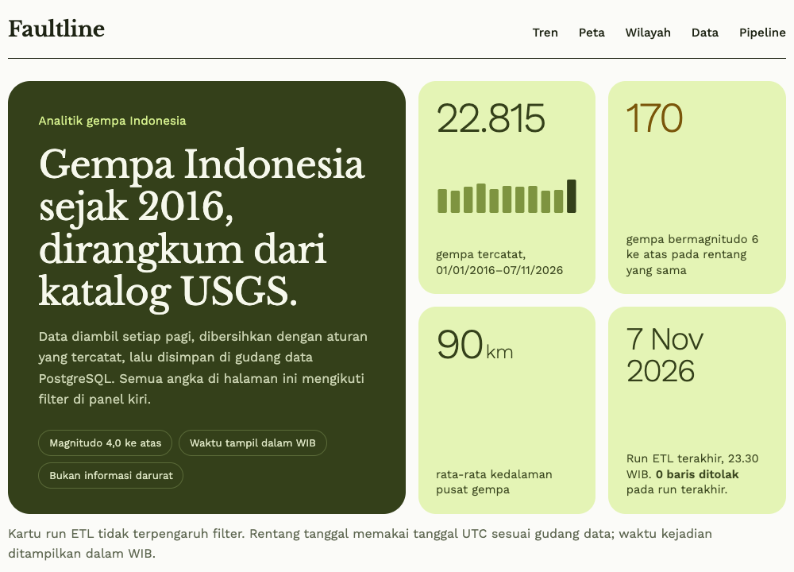
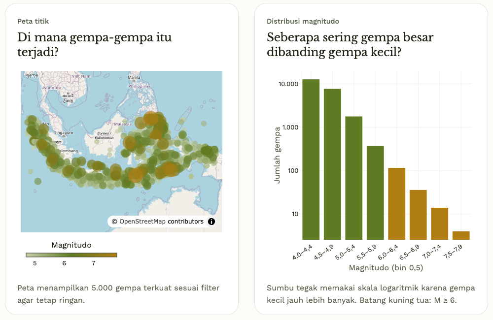
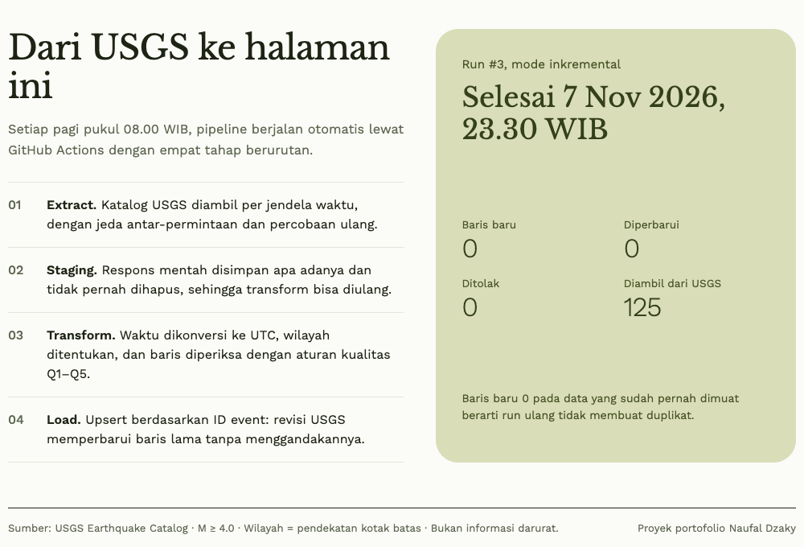
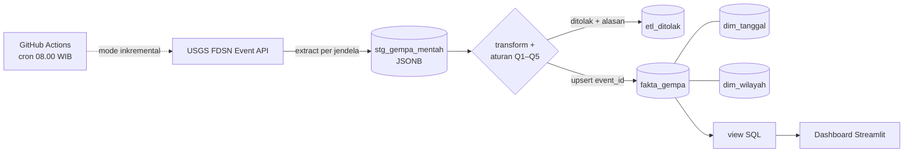

# Faultline — Analitik Gempa Indonesia

Pipeline data gempa Indonesia dari ujung ke ujung. Data diambil otomatis setiap hari dari katalog USGS, dibersihkan dengan aturan kualitas yang tercatat, lalu dimuat ke gudang data PostgreSQL berbentuk star schema. Hasilnya dianalisis di dashboard Streamlit.

> **Batasan penting.** Data berasal dari [USGS Earthquake Catalog](https://earthquake.usgs.gov/fdsnws/event/1/), **bukan BMKG**. Faultline adalah proyek analitik portofolio, **bukan sumber informasi darurat atau peringatan dini gempa**. Wilayah ditentukan dengan pendekatan kotak batas lintang/bujur, bukan batas provinsi resmi.



| Peta dan distribusi magnitudo | Pipeline dan hasil run terakhir |
|---|---|
|  |  |

Tangkapan layar halaman penuh: [`docs/screenshots/dashboard.png`](docs/screenshots/dashboard.png). Data per 7 November 2026.

## Alur data



| Tahap | Modul | Isi |
|---|---|---|
| Extract | `etl/extract.py` | Query USGS per bulan (backfill) atau 30 hari terakhir (harian). Jeda 1 detik antar-request, retry 2/4/8 detik untuk 429/5xx, `orderby=time-asc`. |
| Staging | `etl/load.py` | Setiap fitur disimpan apa adanya (JSONB) bersama `run_id`. Tidak pernah dihapus, sehingga transform dapat diulang tanpa memanggil API. |
| Transform | `etl/transform.py`, `quality.py`, `wilayah.py` | Fungsi murni: waktu ms → UTC, `[bujur, lintang, kedalaman]`, kelas magnitudo dan kedalaman, wilayah, serta aturan kualitas. |
| Load | `etl/load.py` | Upsert ke `fakta_gempa`, simpan penolakan, dan catat hitungan di `etl_log`. Commit per jendela. |
| Analitik | `sql/003_view.sql`, `dashboard/` | View SQL dan dashboard dengan filter tanggal, magnitudo, dan wilayah. |

## Model data (star schema)

```
                 dim_tanggal (tanggal_id YYYYMMDD, tahun, kuartal, bulan, nama_bulan, hari_minggu)
                      ▲
fakta_gempa ──────────┤   satu baris = satu gempa (event_id USGS)
  magnitudo, kelas, kedalaman, kelas, lintang, bujur, tempat, tsunami, status, diperbarui_pada
                      ▼
                 dim_wilayah (8 wilayah kotak batas)

Pendukung: stg_gempa_mentah (JSONB mentah) · etl_log (satu baris per run) · etl_ditolak (baris ditolak + alasan)
```

Skema lengkap ada di `sql/001_skema.sql` dan [`docs/ARCHITECTURE.md`](docs/ARCHITECTURE.md).

## Keputusan desain

**Idempoten lewat upsert.** `event_id` USGS menjadi primary key. Load memakai:

```sql
INSERT INTO fakta_gempa (...) VALUES (...)
ON CONFLICT (event_id) DO UPDATE SET ..., diperbarui_pada = EXCLUDED.diperbarui_pada
WHERE fakta_gempa.diperbarui_pada < EXCLUDED.diperbarui_pada
RETURNING (xmax = 0) AS baru;
```

Run ulang untuk rentang yang sama tidak menambah baris. Revisi USGS, misalnya magnitudo diperbarui atau status `automatic` → `reviewed`, memperbarui baris lama. Klausa `WHERE` mencegah data yang lebih tua menimpa data yang lebih baru. `xmax = 0` membedakan insert dari update untuk `etl_log`.

**Run harian mengambil 30 hari, bukan 1 hari.** USGS dapat merevisi event beberapa hari setelah kejadian. Jendela 30 hari menangkap event baru sekaligus revisinya. Karena upsert idempoten, data yang tumpang tindih tidak menjadi duplikat.

**Commit per jendela bulanan.** Kegagalan di bulan ke-90 tidak membatalkan 89 bulan sebelumnya. Run tetap tercatat `gagal` beserta pesannya di `etl_log`.

**Waktu disimpan UTC.** `tanggal_id` diturunkan dari tanggal UTC. Konversi ke WIB hanya dilakukan di dashboard.

**Pembulatan sebelum klasifikasi.** Magnitudo dibulatkan ke satu desimal (seperti `NUMERIC(3,1)`) sebelum diberi kelas. Contohnya, 4,95 tersimpan sebagai 5,0 dan berkelas `sedang`, sehingga kelas selalu cocok dengan angka di tabel.

**Angka dashboard dari SQL.** Semua agregasi dikerjakan PostgreSQL. Dashboard mengagregasi view datar `v_gempa` dengan `WHERE` berparameter supaya filter memengaruhi semua visual. Lihat [ADR 001](docs/decisions/001_view-datar-untuk-filter.md).

## Aturan kualitas data

| Kode | Aturan | Tindakan |
|---|---|---|
| `Q1` | Magnitudo, koordinat, kedalaman, `time`, `updated`, atau `id` kosong | Tolak |
| `Q2` | `type` bukan `earthquake` (mis. `quarry blast`) | Tolak |
| `Q3` | Kedalaman < −5 atau > 800 km | Tolak |
| `Q4` | Koordinat di luar kotak Indonesia | Tolak |
| `Q5` | `event_id` muncul dua kali dalam satu batch | Simpan versi `updated` terbaru, catat sisanya |

Tidak ada baris yang dibuang diam-diam. Setiap penolakan masuk ke `etl_ditolak` dengan alasan berawalan kode aturan dan payload aslinya. Dashboard menampilkan jumlah baris yang ditolak pada run terakhir.

## Wilayah (pendekatan kotak batas)

Diperiksa berurutan; kotak pertama yang memuat titik dipakai.

| Urutan | Wilayah | Bujur | Lintang |
|---|---|---|---|
| 1 | Jawa | 105,0 – 115,0 | −9,5 – −5,5 |
| 2 | Bali & Nusa Tenggara | 114,4 – 127,5 | −11,0 – −7,5 |
| 3 | Sumatra | 95,0 – 106,5 | −6,5 – 6,0 |
| 4 | Kalimantan | 108,5 – 119,0 | −4,5 – 5,0 |
| 5 | Sulawesi | 118,5 – 125,5 | −6,5 – 2,5 |
| 6 | Papua | 130,5 – 141,0 | −9,5 – 1,0 |
| 7 | Maluku | 124,0 – 135,0 | −8,5 – 3,0 |
| 8 | Lainnya | sisanya | |

Kotak saling tumpang tindih, sehingga urutan menentukan hasil. Contohnya, Selat Sunda masuk Jawa. Gempa di laut dan perbatasan bisa masuk wilayah tetangga. Kolom `tempat` asli dari USGS tetap disimpan sebagai pembanding.

## Idempoten — bukti dua kali backfill

Backfill 2016-01-01 s.d. 2026-11-07 (131 jendela bulanan) dijalankan dua kali pada database yang sama:

| Run | Diambil | Insert | Update | Ditolak | Baris `fakta_gempa` | Durasi |
|---|---|---|---|---|---|---|
| 1 | 22.815 | 22.815 | 0 | 0 | 22.815 | 2 mnt 15 dtk |
| 2 | 22.815 | **0** | **0** | 0 | **22.815** | 2 mnt 11 dtk |

Run kedua mengambil data yang sama persis, tetapi tidak ada baris baru maupun perubahan: upsert mengenali setiap `event_id` dan klausa `WHERE` melewatkan baris yang tidak lebih baru. Staging bertambah (45.630 baris) karena setiap run menyimpan salinan mentahnya sendiri, sesuai prinsip data mentah tidak dibuang. Run inkremental 30 hari berikutnya juga menghasilkan 0 insert dan 0 update.

## Menjalankan

Butuh Python 3.11+ dan PostgreSQL (Neon atau lokal).

```bash
python -m venv .venv
source .venv/bin/activate
pip install -r requirements.txt
cp .env.example .env          # isi DATABASE_URL
```

```bash
python -m etl.run --mode init                         # jalankan sql/ yang belum pernah dijalankan
python -m etl.run --mode backfill --mulai 2016-01-01  # isi awal (±2–3 menit)
python -m etl.run --mode inkremental                  # 30 hari terakhir
streamlit run dashboard/app.py                        # dashboard lokal
```

`--mode init` mencatat migrasi yang sudah dijalankan di tabel `skema_migrasi`, sehingga aman diulang. Backfill menerima `--akhir YYYY-MM-DD` untuk rentang yang lebih pendek.

### PostgreSQL lokal tanpa Neon (opsional)

```bash
initdb -D .pgdata -U postgres --auth=trust -E UTF8
pg_ctl -D .pgdata -o "-p 5433" -l .pgdata/server.log start
createdb -h 127.0.0.1 -p 5433 -U postgres faultline
createdb -h 127.0.0.1 -p 5433 -U postgres faultline_test   # untuk test integrasi
```

`.pgdata/` tercantum di `.gitignore`.

## Test

```bash
pytest
```

Test mencakup konversi waktu, urutan koordinat GeoJSON, batas kelas kedalaman dan magnitudo, wilayah kota dan laut, aturan Q1–Q5, retry extract tanpa jaringan, pembagian jendela, serta format angka Indonesia. Bila `TEST_DATABASE_URL` diatur, test integrasi juga menguji upsert sungguhan: run kedua tidak menambah baris, revisi memperbarui baris, data lama tidak menimpa data baru, dan jendela gagal tidak meninggalkan baris setengah jadi. **Isi database test dihapus setiap test.**

## Otomatisasi

`.github/workflows/etl-harian.yml` berjalan setiap hari pukul 01.00 UTC (08.00 WIB) dan dapat dipicu manual (*Run workflow*). Langkahnya: test, `--mode init`, lalu `--mode inkremental`. `DATABASE_URL` dibaca dari GitHub Secrets. Dashboard membaca `DATABASE_URL` dari Secrets Streamlit atau variabel lingkungan.

## Struktur

```
etl/         config, extract, transform, quality, wilayah, load, run (CLI)
sql/         001 skema · 002 dim_tanggal 2016–2030 · 003 view analitik
dashboard/   app.py (Streamlit) · queries.py (semua SQL dashboard) · format.py
tests/       pytest + fixture fitur USGS asli
docs/        brief, arsitektur, konvensi, desain, roadmap, ADR
```

## Status

Pipeline, test, dan dashboard sudah berjalan lokal dengan data USGS asli. Database Neon, GitHub Secrets, run otomatis di GitHub Actions, dan deploy Streamlit Community Cloud belum dilakukan.
